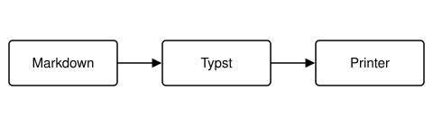
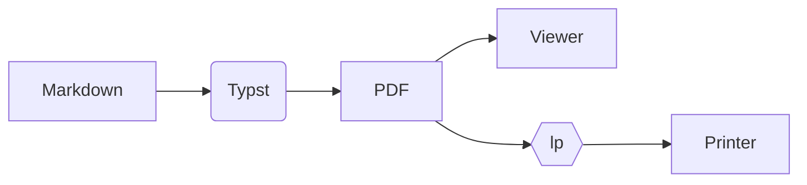

# Why print at all

Reading on paper is slower, and that is the point. A printed page invites a pen, a margin note, and a second pass. This long paragraph exists to exercise justification and hyphenation: Typst breaks lines a paragraph at a time with the Knuth–Plass algorithm, weighing every possible set of breakpoints against one another, so that the interword spacing stays even and rivers of white are rare even in a fairly narrow measure. Words such as *internationalization*, *incomprehensibilities*, and *electroencephalography* give the hyphenator something to chew on, while "smart quotes" and an em dash --- like this --- check that punctuation comes out typographically correct.

## A short checklist

1. Write the document in Markdown.
2. Render it:
   - preview on screen first,
   - then print it:
     - single-sided for drafts,
     - duplex for anything longer than a few pages.
3. Recycle the draft.

## Inline elements

Read the [Typst documentation](https://typst.app/docs/) for the details, and the [cmarker package](https://typst.app/universe/package/cmarker) for how the Markdown is parsed. Links to the [same docs](https://typst.app/docs/) on the same page are footnoted only once. A bare URL such as <https://example.com/a/fairly/long/path> needs no footnote, and neither does https://github.com/typst/typst. Inline code looks like `typst compile`.

### A table

| Engine    | Line breaking     | Hyphenation | Speed  |
|-----------|-------------------|-------------|--------|
| Typst     | Knuth–Plass       | Yes         | Fast   |
| LaTeX     | Knuth–Plass       | Yes         | Slower |
| Browser   | Greedy (mostly)   | Partial     | Fast   |

### Code

```python
def split_front_matter(text):
    m = re.match(r"\A---\n(.*?)\n---\n", text, re.S)
    return (m.group(1), text[m.end():]) if m else (None, text)
```

```bash
typst compile --root / --input paper=us-letter --input color=false --input link-footnotes=true main.typ "$HOME/Documents/some/rather/deeply/nested/output-directory/final-version.pdf"
```

## Quoting

> The purpose of typography is to make reading easy and pleasant, and to get out of the way while doing it. A blockquote should be readable on a cheap laser printer.

## A picture



## A diagram



## Closing

That's all. One more paragraph so the page has some weight at the bottom, and so that any heading close to the page break would be pushed onto the next page together with its text instead of being stranded at the foot of the page.
